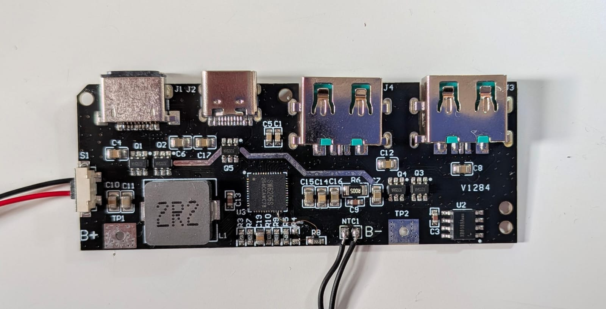
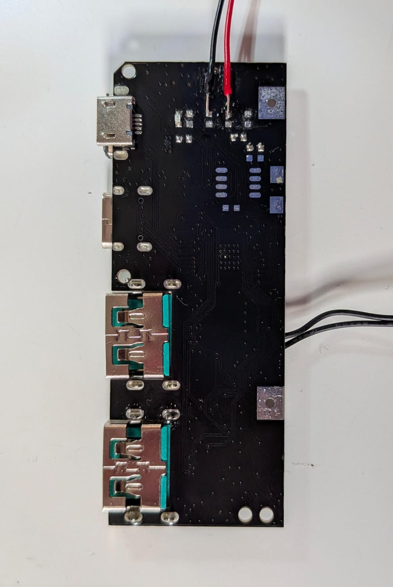
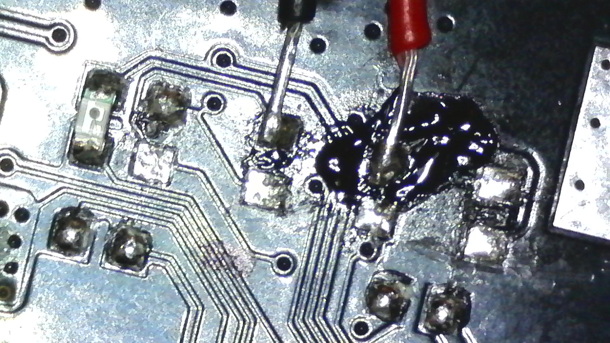
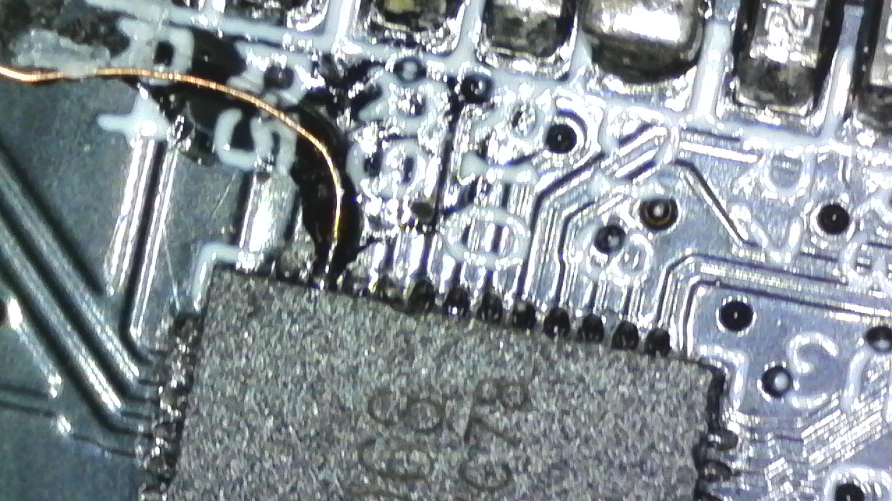
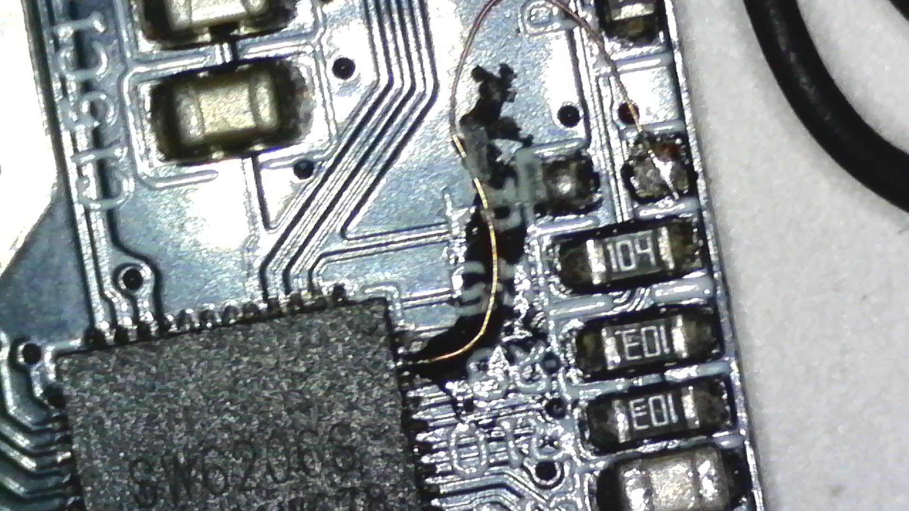

# SW6206S 22.5 W power bank module: reading it over I2C

Notes, photos and a small test firmware for the generic **22.5 W "SW6206" power bank module** (board marking `V1284`, chip `SW6206S`, two USB-C ports, two USB-A ports, `B+` / `B-` / `NTC1` pads). The goal: read the charger chip's status registers from a microcontroller. It works, but the I2C mode needs one hardware change that the module does not offer by itself.

## Short version

1. The chip is an **SW6206S** (ISmartware / Injoinic family, QFN-48 6x6 mm). It is an I2C **slave at 7-bit address `0x3C`**.
2. Pin 23 (`LED4/I2C`) selects the mode. **It must be connected to GND for I2C to work.** On this module pin 23 is **not connected to anything else on the board**. You have to solder a wire from that pin (its pad) **directly to GND**. After that the I2C bus is active.
3. Pin 26 (`LED1/SCK`) becomes **SCL** and pin 25 (`LED2/SDA`) becomes **SDA**. These are the LED pins of the module.
   - On this board version (`V1284`) the LED pads are: **the 3rd LED pad from the top is SCL, the 2nd LED pad from the bottom is SDA.** Other versions of the module may differ. Always confirm with a **continuity test with a multimeter** from the pad to the chip pin (pin 26 for SCL, pin 25 for SDA, pin 23 for the mode pin) before soldering.
4. A Raspberry Pi Pico (RP2040) as I2C master at 10 kHz, with the Pico's internal pull-ups, reads the chip. All 256 registers can be dumped ([docs/register-dump.md](docs/register-dump.md)).

## Chip facts (from the manufacturer's datasheet DS035 v1.5, May 2022; not included here)

| Item | Value |
|---|---|
| Part | SW6206 (this module: SW6206S) |
| Package | QFN-48, 6 x 6 mm |
| Function | Multi-protocol two-way fast charging power bank SoC: 5 A switching charger, up to 22.5 W boost output, PD 3.0 / PPS, QC 4+/3.0/2.0, AFC, FCP, SCP, PE, SFCP |
| Battery | single cell Li-ion, 4.2 / 4.35 / 4.4 / 4.5 V types, 2.8 to 4.5 V |
| Measurement | built-in 12-bit ADC and coulomb counter, 3 to 5 LED fuel gauge |
| I2C | 100 / 400 kHz, slave address `0x3C`, example register `0xB0` in the datasheet |
| I2C pins | pin 23 `LED4/I2C` (mode select), pin 25 `LED2/SDA`, pin 26 `LED1/SCK`, pin 24 `LED3/IRQ` (optional interrupt) |
| Mode select | LED pins are LED drivers by default. With pin 23 tied to GND they become I2C (SCK, SDA, IRQ). |

The datasheet only gives the slave address and the bus protocol. It does **not** publish a register map.

## The hardware change

- Pin 23 is a bare pad/pin on this module. Nothing on the board pulls it to GND. Solder a thin wire from the pin (or its nearest pad) to a GND point (for example a ground pad or the `B-` pad). This is a micro-soldering job on a QFN pin: see the macro photos.
- Only then are the LED pads (pin 25 and 26) an I2C bus. Without the wire the pads stay LED drivers and show slow low pulses and noise (this is what a logic analyser sees before the change).
- Share ground between the module and the master.

## Photos: where and how to connect

**Overview, front side** (`U3` = SW6206S, `J1`/`J2` USB-C, `J3`/`J4` USB-A, `U2` second IC, `L1` 2R2, `B+`, `B-`, `NTC1`, `S1`):

**Back side**, with two leads on the top pads. The LED pads are counted from the top in this view (3rd LED pad from the top = SCL, 2nd LED pad from the bottom = SDA):

**Continuity test.** The multimeter probe tip is clamped in a pair of tweezers to get a finer tip. Test every pad against the chip pin before soldering:

**Thin enamel wire soldered directly to a chip pin at the QFN edge** (microscope):

**Enamel wires at the chip corner**, next to the resistors marked `104` and `E01` (microscope):

## Test setup (what was used)

| Pico (RP2040) | SW6206S |
|---|---|
| GP4 (pin 6) = SDA | pin 25, `LED2/SDA` |
| GP5 (pin 7) = SCL | pin 26, `LED1/SCK` |
| GND | GND, and the wire to pin 23 |

- 3.3 V logic. The Pico's internal pull-ups (about 50 kOhm) were enough at 10 kHz.
- Firmware: [firmware/pico-i2c](firmware/pico-i2c) (PlatformIO, Arduino framework, bit-banged I2C, open drain). It dumps all registers over USB serial at 115200 baud.

## What was measured

- The chip ACKs address `0x3C` in every scan; the sequence address, register `0xB0`, repeated start, read address is ACKed. Register `0xB0` reads `0x00`.
- The bus is not clean: from time to time SDA is pulled low from outside for a few hundred milliseconds, so single reads sometimes get a NAK. Read a register more than once and vote.
- Only register `0x9E` changed over 45 s (`0x91` / `0x9D`), the rest was constant in that state.
- Registers `0x80` to `0x8F` hold an increasing table (`06 10 18 22 2C 34 39 3E 42 46 4E 56 5D 62`). It looks like a voltage-to-percent table for the fuel gauge. This is a guess.
- The meaning of the other registers is **not known**. If you have the register map or compare dumps while charging, discharging or with load, please open an issue.

## Licence

Firmware and text: MIT, see [LICENSE](LICENSE). Photos: CC BY 4.0.
